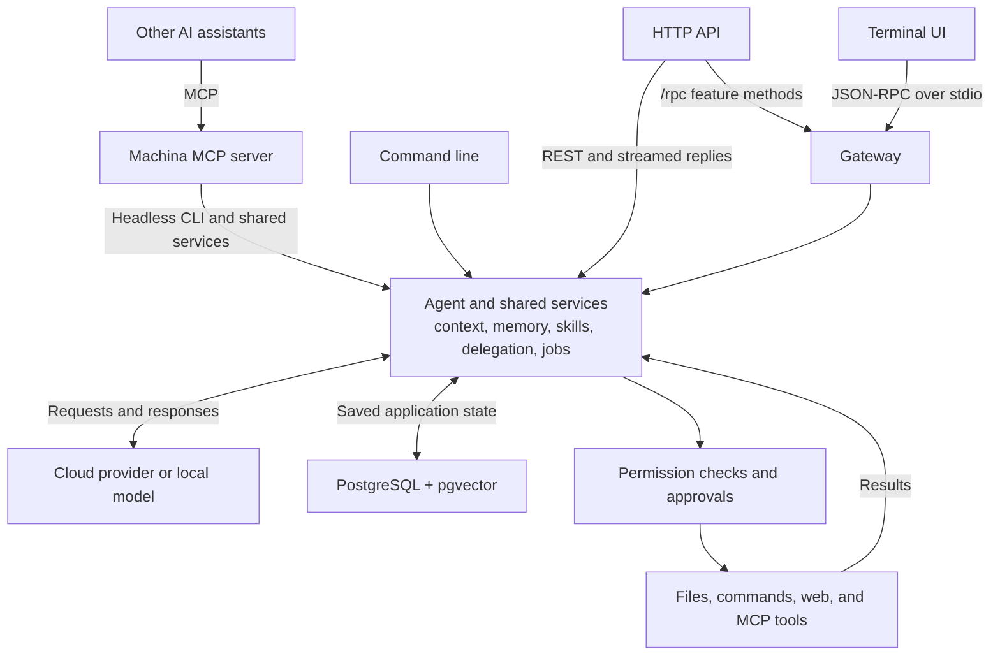

# Machina

**An AI workspace in your terminal, with memory, tools, and a choice of models.**

Machina helps you work on code, research questions, and automate recurring tasks. Chat beside your files, ask specialist agents to help, and return to saved conversations later. You run the application and its database yourself; connect a cloud AI provider, a supported subscription account, or a local model.


- **Work in one place.** Chat, edit files, browse your project, and review changes in the terminal.
- **Keep useful context.** Save conversations, search documents, and carry preferences and lessons into future work.
- **Choose your AI.** Switch providers and models, including local models through Ollama.
- **Give agents practical tools.** Read and write files, run commands, research the web, and connect external services.
- **Control sensitive actions.** Review approvals and choose how much authority each session has.
- **Build on the same backend.** Use the interactive UI, command line, HTTP API, or integrations with other AI tools.

**Release status:** 0.2.0 development release candidate. See [release evidence and remaining deployment gates](docs/verification/RELEASE_READINESS.md) before operating a public service.

## Contents

- [Get started](#get-started): requirements, installation, and your first conversation
- [Features](#features): workspace, saved sessions, context, search, skills, agents, and automation
- [How it works](#how-it-works): the agent loop, architecture, and where data goes
- [Providers and models](#providers-and-models): connections, credentials, and model selection
- [Permissions and security](#permissions-and-security): modes, approvals, scripts, and secrets
- [Configuration](#configuration): settings, defaults, and environment variables
- [HTTP API and Docker](#http-api-and-docker): application integration and deployment
- [Development](#development): tests, CI, and the source tree
- [Documentation](#documentation) · [Troubleshooting](#troubleshooting) · [License and credits](#license-and-credits)

## Get started

### Requirements

| Component | Required for |
|---|---|
| Python 3.11+ | The backend and command line |
| PostgreSQL 16+ with pgvector | Saved conversations, memory, and application state |
| Node.js 22.19+ and npm | The interactive terminal UI |
| An AI provider or local model | Generating responses and using agent tools |

The installer supports macOS, Linux, and Git Bash on Windows. It can provision a local database with Docker, or Homebrew on macOS. The terminal UI needs an interactive terminal; Node.js is optional for command-line and HTTP use.

### Install and launch

```bash
curl -fsSL https://raw.githubusercontent.com/kiazh/Machina-Harness/main/install.sh | bash

machina setup     # choose a provider and configure credentials
machina init      # initialize the configured database
machina doctor    # check the database, provider setup, and prerequisites
machina           # open the terminal UI
```

The [installer](install.sh) creates a Python environment, installs backend and UI dependencies, prepares `.env`, attempts database initialization, and adds a `machina` launcher to your path. Open a new shell if the launcher is not found. From an existing checkout, use `bash install.sh`.

For more control, download the installer and use `--help`. The main options are:

| Option | What it changes |
|---|---|
| `--dir DIR` | Choose where Machina is installed. |
| `--dev` | Include Python development and testing tools. |
| `--no-ui` | Install only the backend and command line. |
| `--interactive` | Allow setup questions even when the script is piped into Bash. |
| `--yes` | Run without setup questions. |
| `--with-docker-db` | Use Docker for database provisioning if initialization fails. |
| `--no-docker-db` | Do not use Docker to provision a database. |
| `--no-auto-db` | Leave all database provisioning to you. |
| `--no-shell-rc` | Do not edit your shell startup files. |
| `--skip-init` | Leave database initialization to you. |
| `--interop auto\|all\|none` | Control registration with detected external AI assistants. |

<details>
<summary>Install manually from source</summary>

Create a PostgreSQL database with pgvector available, then:

```bash
git clone https://github.com/kiazh/Machina-Harness.git machina
cd machina
python3 -m venv .venv
source .venv/bin/activate
pip install -e .
npm ci --ignore-scripts --prefix ui

umask 077
cp .env.example .env
chmod 600 .env
# Set DATABASE_URL in .env to your PostgreSQL database.
machina setup
machina init
machina doctor
machina
```

The activation command above is for macOS/Linux shells. Omit the npm step for backend-only use. A Python wheel includes the backend and bundled skills; the terminal UI and its Node dependencies require a source checkout or a separately configured `MACHINA_UI_DIR`.

Optional Python extras install additional dependencies. For example, `pip install -e ".[dev,embeddings-onnx,rerank]"` adds development tools, local embedding support, and reranking.

| Extra | What it adds |
|---|---|
| `dev` | Python testing, formatting, linting, and security tools |
| `embeddings-local` | Model2Vec for local search by meaning |
| `embeddings-onnx` | FastEmbed/ONNX for local embedding models |
| `rerank` | Local ONNX models that reorder search results |
| `secrets` | AWS Secrets Manager dependencies |
| `connectors` | Compatibility extra; MCP is already in the base installation |
| `workflow-trial` | Dependencies for the separate workflow-trial tooling |

CI and container builds install dependencies from `uv.lock`; a manual `pip install -e .` uses pip's resolver. Local skill directories can be selected with `MACHINA_SKILLS_DIR` and `MACHINA_LEARNED_SKILLS_DIR`.

</details>

### Try a first task

In the UI, ask something concrete:

```text
Explain how this project is organized and where its main entry point is.
```

Use `/help` for the searchable command menu. Open `/workspace open .` to browse the current project, `/models` to choose a model, and `/sessions` to return to earlier work.

For a single response without opening the UI:

```bash
machina chat "Summarize the repository layout"
machina chat -c "Continue from the last session"
machina chat -s "<session-id>" "Resume this conversation"
```

## Features

Jump to [the workspace](#chat-and-code-side-by-side), [saved sessions](#save-search-and-resume-conversations), [long-task context](#keep-long-tasks-within-the-models-reading-limit), [usage](#track-usage-and-set-budgets), [document search](#search-documents-and-research-the-web), [memory](#remember-useful-information-between-conversations), [skills](#reuse-task-instructions-with-skills), [personality](#shape-personality-and-learn-from-feedback), [specialists](#delegate-to-specialist-agents), [scheduled work](#schedule-recurring-work), or [integrations](#connect-tools-and-other-ai-assistants).

### Chat and code side by side

The terminal UI combines **streaming chat**—responses appear as they are generated—with a file editor, tabs, a project explorer, and a problems panel. You can keep a conversation beside the code it concerns, expand either pane, and switch focus without leaving the terminal.

Quick Open finds files by a partial name. Tabs can be temporary previews or pinned files you want to keep open. Modified, conflicting, and read-only files have visible text labels. Layout, open-file locations, and cursor positions are saved per project; this layout state does not store document contents.

When a file changes on disk after you opened it, saving offers a choice: reload, explicitly overwrite, or keep editing. Closing a modified tab or quitting with unsaved files also gives you a chance to save or cancel. Binary and oversized files open in a read-only view rather than an unsuitable text editor.

**Language intelligence** comes from optional language servers: separate programs that understand a programming language. Machina supports `pyright-langserver` for Python and `typescript-language-server` for JavaScript/TypeScript. They can provide completion, hover explanations, definitions, references, symbols, and diagnostics. A missing server is reported as missing; ordinary editing still works. Only install and enable servers you trust, since they run with your operating-system privileges.

Paste or drop supported images into chat, attach selected code, or ask the agent to inspect files with its tools. Opening a file in the editor does not automatically send its contents to the model. The explicit attachment flow shows the file, range, version, and whether the text includes unsaved edits. Agent file reads remain subject to tool permissions.

| Action | Command or shortcut |
|---|---|
| Send a message / add a new line | `Enter` / `Shift+Enter` |
| Find commands | `/help` |
| Open a project | `/workspace open <path>` |
| Find a file | `Ctrl+P` or `/quickopen` |
| Save / close the active editor tab | `Ctrl+S` / `Ctrl+W` |
| Show or hide the file explorer | `Ctrl+T` or `/explorer` |
| Change pane focus | `F6` / `Shift+F6` |
| Show code completion | `Ctrl+Space` or `/editor complete` |
| Go to definition / find references | `F12` / `Shift+F12` |
| Preview a symbol rename, when supported | `F2` |
| Maximize chat from the editor | `Ctrl+Right` |
| Restore the split from the editor or maximized chat | `Ctrl+Left` or `/workspace split` |
| Paste an image | `Ctrl+V` |
| Stop a response | `Esc` after dismissing any open popup |
| See keyboard shortcuts | `F1` or `?` on empty input |
| Change appearance / editor preferences | `/theme` / `/settings` |

Some terminals or operating systems intercept shortcuts. The slash commands provide fallbacks. In split mode, the chat input keeps its normal `Ctrl+Left/Right` word movement; `Ctrl+W` closes tabs only outside the chat input.

The UI includes theme previews, a transparent-background option, syntax highlighting, soft wrap, and tab-width preferences. An optional **now-playing bar** shows local music or media information. On macOS, detection can use system media interfaces, installed helper tools, Spotify/Music, or supported browser tabs; some methods need Automation permission. Use `/music off` to hide it. Detection is local and does not send media metadata to the model.

See the [workspace guide](docs/design/WORKSPACE.md), [UI design](docs/design/TUI_DESIGN.md), and [theme reference](docs/design/THEME_COLORS.md). Machina's terminal command tool is separate from the editor; there is no embedded terminal pane.

### Save, search, and resume conversations

A **session** is a saved conversation and its working state. PostgreSQL stores the messages and context needed to return to it after a restart. The command line, UI, and HTTP API use the same saved state when configured for the same database.

You can name a session, give it a goal, search older conversations, resume one, export it as Markdown, or **fork** it to explore another direction in a new session. Delegated work gets its own child sessions, so specialist conversations do not have to take over the main thread.

| Task | UI command |
|---|---|
| Start fresh / return to earlier work | `/new` / `/sessions` or `/resume` |
| Find a conversation / recall earlier content | `/search` / `/recall` |
| Name the conversation / set its goal | `/rename` / `/goal` |
| Explore a separate branch | `/fork` |
| Save a readable copy / delete a session | `/export` / `/delete` |

The CLI also supports `machina sessions`, `sessions-search`, `export`, `fork`, and `delete`. Run a command with `--help` for its arguments. `machina chat -c` continues the last session, while `-s <session-id>` selects one explicitly.

### Keep long tasks within the model's reading limit

A model can read only a limited amount of text per request. That limit is its **context window**, measured in **tokens**: small units of text that do not correspond exactly to words. Long conversations and large command outputs can fill that window quickly.

Machina combines several approaches instead of resending every detail forever:

| Mechanism | What it does |
|---|---|
| Context compression | Summarizes older material so recent work has room. |
| Automatic compaction | Checks for compaction after turns, reducing the need to do it manually. |
| Saved artifacts | Retains large tool results so omitted detail can be retrieved later. |
| Format-aware reduction | Produces smaller views of test output, logs, JSON, CSV, diffs, and code. |
| Request projection | Chooses the working view sent to the model while preserving required instructions and related tool messages. |
| Retrieval selection | Removes duplicate retrieved excerpts and fits evidence into a separate reading budget. |

For example, a long test log can be stored in full while the model receives failure details and a recovery handle. It can then ask for a specific part of the original instead of running the tests again merely to recover omitted text.

**Recovery has explicit limits.** A smaller, recoverable view is published only after the original result has been stored. If storage fails, a quota is reached, or the result exceeds the storage limit, Machina falls back to its ordinary bounded output without claiming the missing text is recoverable. A source that was already truncated upstream remains marked as such. A summary is not a guarantee that every detail is still in the current prompt.

Saved artifacts support paged reads, literal search, and metadata inspection through `artifact_read`, `artifact_search`, and `artifact_describe`. Reads are authorized again each time. Related parent/child sessions can recover evidence within their delegation tree; unrelated sessions cannot. Paging cursors identify the source version, and expired evidence is reported as unavailable. Defaults are 30 days of retention, 500 artifacts per session, and 2,000,000 characters per artifact; quotas refuse new stores rather than evicting existing evidence to make room.

The request planner keeps pinned instructions intact and preserves related tool-call groups together. It can substitute a verified smaller view for an older observation, but only when its stored source is available and complete. Retrieval selection similarly removes exact duplicates without treating conflicting passages as duplicates, and tells the model when lower-ranked excerpts were omitted.

Use `/context` to inspect working context and `/compress` for manual compaction. [Context and token efficiency](docs/TOKEN_EFFICIENCY.md) explains the mechanisms and failure behavior. [Projection evidence](docs/verification/DETERMINISTIC_SKILLS_B3_EVIDENCE.md) records a real DeepSeek run; it does not establish correct replay of every provider's protected or signed message format.

### Track usage and set budgets

`/usage` and `machina usage` show recorded model usage. Machina normalizes provider reports so ordinary input, cached input, cache writes, and output can be accounted for consistently. It also records which session and agent made a call and whether the call was for the main task, a summary, memory processing, or skill learning.

Missing usage is not treated as zero. Costs are estimates from known price records or configured overrides; an unknown model price remains unknown. Retries and supporting model calls can consume tokens even if the final answer fails. Session and agent limits can cap token consumption or request counts; `0` means unlimited. These are application budgets, not a replacement for a provider-side spending limit.

**Prompt caching** is a separate, optional feature. Where a provider supports it, stable instructions and repeated request prefixes may be reused by that provider. Machina's explicit prompt-cache integration is off by default and only adds cache markers for supported provider/model paths. It does not cache answers to arbitrary questions, and no fixed cost or speed improvement is promised.

Automatic model switching based on task difficulty, semantic answer caching, cache warmers, and learned token-pruning models are not enabled features. The current efficiency work focuses on measuring usage and reducing repeated text while keeping omitted evidence recoverable where possible.

### Search documents and research the web

Machina can index documents and retrieve relevant passages while answering a question. This is often called **retrieval-augmented generation (RAG)**: give the model selected source material alongside the question instead of expecting it to know your documents already.

The document tools split material into searchable pieces and keep it associated with the session. `index_document` adds material and `search_documents` finds it. Web tools provide search, page extraction, bounded multi-page crawls, and research workflows. A crawl can add the collected pages to the session's document search.

Search is **keyword-only by default**. Optional search components add other ways to find and order results:

| Search component | Plain-language meaning | Available backends |
|---|---|---|
| Embeddings | Turn text into numerical representations so similar meanings can match even with different words. | Local Model2Vec, local ONNX/FastEmbed, an OpenAI-compatible embedding API, or automatic selection |
| Hybrid search | Combine keyword matches with meaning-based matches. | Configurable keyword and embedding weights |
| Reranking | Take retrieved candidates and evaluate which best match the question. | Local ONNX, Cohere, an HTTP reranking service, or automatic selection |

Local embeddings need `embeddings-local` or `embeddings-onnx`; local reranking needs `rerank`. Remote backends require their endpoint or credentials and send the relevant text to that service. Selecting a local chat model alone does not configure local embeddings or reranking.

The default hybrid weights are `1.0` for keywords and `0.25` for embedding results, applied only when embeddings are enabled. Memory retrieval uses relevance ranking, with recency and importance as tie-breakers. Additional search components are optional because they add cost and latency and do not improve every dataset; see the [retrieval-quality review](docs/verification/RAG_QUALITY_REVIEW.md).

### Remember useful information between conversations

**Memory** is distinct from both the current conversation and document search. It stores useful facts, preferences, and lessons for later retrieval. For example, a conversation may establish a lasting project convention that should be available when a later task needs it.

Conversation consolidation can extract candidate memories, score their importance, and check for duplicates before saving. You can inspect, search, and forget entries through `/memory` or the CLI. User profiles and agent lessons have separate roles; persona-aware retrieval uses the active persona to help select relevant memories.

**Memory approval is off by default.** With `memory_approval_enabled` enabled, writes go to a pending queue where you can approve or reject them. Without it, accepted writes are saved directly. CLI controls include `memory-pending`, `memory-approve`, `memory-reject`, and their bulk variants.

Memory text is passed through secret redaction before storage; if that redaction cannot be completed, a marker replaces the content. This is a safeguard, not a reason to put credentials into conversations. Memories can also be incomplete or wrong: use the inspection and forgetting controls to correct them.

### Reuse task instructions with skills

A **skill** is an instruction package, usually a `SKILL.md` file, that explains how to approach a type of task. A code-review skill might describe what to inspect and how to present findings. Skills provide guidance; they are different from executable tools, model training, or permission grants.

Machina includes first-party skills and a curated [ECC collection](docs/ECC_SKILLS.md). `/skills` lets you browse, search, inspect, learn, review proposals, revert changes, and manage the catalog. Each skill's source and revision are tracked so the system can distinguish bundled, installed, and learned content.

Routing uses catalog metadata—task types, languages, tools, exclusions, and relevant sections—to rank candidates with repeatable rules. Once the task description is formed, this matching does not require another model call. **Stage-aware loading** means a planning stage can receive planning instructions and their prerequisites without loading every later implementation or review section at once. This makes large skill collections easier to use within a limited context window.

Metadata is validated separately from the instruction body. Invalid values, circular section dependencies, excessive sizes, and fields that pretend to grant authority are rejected or ignored according to the metadata format. Bundled ECC routing additions are stored in a separate, revision-bound file; if it no longer matches the bundle, Machina reports the mismatch and uses baseline metadata instead.

Newly installed or learned skills without the newer metadata can receive a one-time model-generated metadata block. The instruction body is preserved. If generation or validation fails, the skill keeps its original form rather than blocking installation. Later loads reuse persisted metadata instead of generating it again. Browsing, searching, and previewing catalog routes do not themselves run the skill or install anything.

**Learning new skills after turns is opt-in** (`learning_review_enabled: false`). When enabled, its automatic-publishing policy defaults to on, with a cap of five auto-applied skills per agent in a rolling 24-hour period. Set `learning_review_auto_apply: false` or the daily cap to `0` to stage proposals for review. Published learned skills have revisions and a revert path.

The registry also performs a best-effort scan for suspicious instructions. A scan cannot make an untrusted skill safe; skill instructions never bypass tool permissions. See the [skill registry](machina/skills/registry.py), [routing implementation](machina/skills/runtime.py), and [enrichment rules](machina/skills/enrichment/README.md).

### Shape personality and learn from feedback

`/persona` sets the communication style you want, such as “explain clearly, use concrete examples, and keep a warm tone.” This human style override applies across the installation; it does not change the agent's tool permissions or replace its core role.

**Personality growth** stores bounded preferences and lessons owned by an agent. These notes can affect later conversations, including after a restart or provider change. Growth is enabled by default. Use `/growth` to view progress, teach a note, give feedback, forget a note, or restore an earlier revision:

```text
/growth teach style verbosity Explain decisions with one concrete example
/growth teach lesson testing Run focused tests before reporting success
/growth feedback good
/growth show
/growth rollback
```

The related **RSI** feature—runtime self-improvement—uses recorded outcomes and feedback to adjust bounded strategy guidance and memory-retrieval policy. Revisions and trial history make those adjustments inspectable and reversible. This updates saved guidance and policy, not the underlying AI model's weights, and does not grant extra authority.

**SoulSpec packages** let you import or export a structured identity: persona, voice, workflows, and related resources. Export excludes learned notes unless you explicitly include them. Importing an identity preserves the selected agent's ownership and execution settings; the documented restore option is needed to restore an included learned-note snapshot. These packages do not move all chat history or execute bundled scripts.

Read [personality, growth, and identity](docs/PERSONALITY_GROWTH.md) for ownership, disabling learning, package commands, and rollback behavior. This is shared agent persistence within an installation, not isolated user accounts.

### Delegate to specialist agents

An **agent** combines a role or identity with a model/provider choice and an allowed set of tools. Machina provides general-purpose, research, and coding agents, a bundled [ECC specialist collection](docs/ECC_AGENTS.md), and support for custom definitions.

A **subagent** is an agent working on a delegated part of a larger task. For example, a main coding agent can ask a research specialist to inspect an unfamiliar dependency. The specialist gets a child session, returns its result, and remains subject to its own tool restrictions and the permission system.

Delegation can run sequentially when one result is needed by the next step, or in parallel for independent work. The main session can inspect delegated results without combining every child message into its own conversation. `/agents` browses definitions and related sessions; `/delegate` starts an assignment. Delegated work can still pause for approval or fail; creating a subagent does not guarantee a better answer or bypass a budget.

### Schedule recurring work

`/jobs` manages work that should run again while the backend is active:

| Job type | Example use |
|---|---|
| Interval prompt | Check a project every set number of seconds. |
| Cron prompt | Run a task on a five-field UTC schedule. |
| Heartbeat | Nudge an agent to continue its current goal. |
| Script job | Run a specific operator-approved script on a schedule. |

Jobs are saved so their configuration survives restarts, but scheduling needs a running backend. They use the normal agent and permission paths. Script jobs have a separate operator policy specifying allowed entry files and dependencies; adding a path to a prompt is not enough to authorize a script.

### Connect tools and other AI assistants

**MCP (Model Context Protocol)** is a standard way for AI applications to connect to tools. Machina supports it in two directions:

- **Bring tools into Machina.** Add a local program or HTTP MCP server through `/mcp`, review its connection details, and choose which tools the agent can use. Configuration and inspection do not by themselves launch it. Connecting starts the selected program or contacts the endpoint after the required review.
- **Use Machina from another assistant.** `machina harnesses` can register Machina's MCP server with supported OpenCode, Codex, and Hermes installations. That server exposes status, session creation, and a bounded text chat task. It is a focused integration surface, not a remote copy of every UI feature. Machina can also delegate a bounded prompt to a supported external assistant.

For incoming tools, the agent first browses the available catalog, reads a selected tool's description, then requests a specific call. This avoids putting every remote tool description into every model request. Remote tool calls still use ordinary approvals; server-provided descriptions and results do not grant authority.

Supported HTTP servers can use browser-based OAuth sign-in. Machina implements the authorization-code flow with PKCE, which binds the login exchange to the client that started it. A usable desktop credential store or a configured `MACHINA_OAUTH_MASTER_KEY` is needed to protect stored OAuth credentials. Local stdio servers must already be installed; Machina does not download them automatically.

See [MCP setup](docs/MCP.md), [MCP OAuth](docs/MCP_OAUTH.md), and `machina harnesses --help` for connection fields, secret references, trust settings, and supported external-assistant commands.

### Command reference

You can discover commands through `/help` without memorizing them. The main groups are:

| Group | UI commands |
|---|---|
| Session | `/new`, `/resume`, `/sessions`, `/search`, `/recall`, `/rename`, `/fork`, `/delete`, `/export`, `/clear` |
| Task | `/goal`, `/review`, `/init`, `/delegate`, `/agents` |
| Workspace | `/workspace`, `/editor`, `/explorer`, `/lsp`, `/problems`, `/quickopen`, `/attach` |
| Memory and instructions | `/memory`, `/growth`, `/persona`, `/skills` |
| Context | `/context`, `/compress` |
| Automation | `/jobs` |
| Models and setup | `/auth`, `/keys`, `/models`, `/default-model`, `/provider`, `/effort`, `/config`, `/theme`, `/profile`, `/profiles`, `/mode`, `/approvals`, `/interop`, `/harnesses` |
| Information | `/status`, `/usage`, `/output`, `/mcp`, `/music`, `/help`, `/exit` |

Aliases include `/settings` → `/config`, `/model` → `/default-model`, `/providers` → `/provider`, and `/compact` → `/compress`.

For scripting, `machina --help` lists the CLI. In addition to chat and session commands, it includes memory approval/search, skill management, providers/authentication, growth, usage, configuration, and external-assistant integration. `machina`, `machina repl`, and `machina chat -i` open the same terminal UI. Headless `machina chat` exits with `0` for completion, `1` for failure, `3` for an approval pause, and `130` for interruption.

## How it works

Machina runs the agent locally and connects it to your selected model. The model can request tools; Machina checks permissions, executes permitted actions, and returns their results so the conversation can continue.



The UI uses the gateway. The CLI and HTTP chat routes call shared services directly; HTTP also exposes gateway feature methods through `/rpc`. The MCP server uses shared services and headless CLI chat. These are different entry points into the same application.

A typical conversation turn follows this sequence:

1. Machina loads the session, its agent definition, and the configured authority.
2. It assembles instructions, selected skills, recent conversation, and relevant memory or document excerpts.
3. It fits that working context to the selected model's input limit and sends the request.
4. If the model requests a tool, Machina checks the action. It runs permitted actions or pauses for a human decision.
5. Tool results are saved and added to the conversation, using smaller recoverable views when appropriate. The model can continue from those results.
6. When the turn finishes, Machina records usage and performs enabled context, memory, and growth maintenance. Optional skill-learning reviews run only when enabled.

The **gateway** is the authenticated message interface used by the terminal UI. **JSON-RPC** describes a named operation and its arguments; **stdio** means those messages travel through the local child process's input and output streams. The HTTP API instead uses normal HTTP requests and **server-sent events (SSE)** to stream progress. Sharing core services does not mean every surface takes the same transport path.

**Your data:** conversations, memories, documents, approvals, and usage records live in your database. Configuration and credentials also use local files or configured secret stores. When you choose a cloud model, the request's selected context is sent to that provider; web tools and external connectors contact their respective services. Self-hosting the application does not make those services local.

## Providers and models

Choose a provider in `machina setup`, or use `/provider` and `/models` in the UI. The default configuration selects OpenRouter's `openrouter/free` model and needs an OpenRouter key. Model availability, account access, pricing, and tool support depend on the provider.

The table lists provider IDs used in commands, credential names, and the defaults bundled with this source version. These model IDs are application defaults, not a list of the newest models or a guarantee of account access.

| Provider ID | Credential or connection | Bundled default / selection |
|---|---|---|
| `openrouter` | `OPENROUTER_API_KEY` | `openrouter/free` |
| `openai` | `OPENAI_API_KEY` | `gpt-4o-mini` |
| `anthropic` | `ANTHROPIC_API_KEY` | `claude-3-5-sonnet-20241022` |
| `deepseek` | `DEEPSEEK_API_KEY` | `deepseek-chat` |
| `xai` | `XAI_API_KEY` | `grok-4` |
| `groq` | `GROQ_API_KEY` | `llama-3.3-70b-versatile` |
| `together` | `TOGETHER_API_KEY` | `meta-llama/Llama-3.3-70B-Instruct-Turbo` |
| `mistral` | `MISTRAL_API_KEY` | `mistral-small-latest` |
| `google` | `GOOGLE_API_KEY` | `gemini-2.0-flash` |
| `opencode` | `OPENCODE_API_KEY`; optional `OPENCODE_BASE_URL` | `big-pickle` through OpenCode Zen |
| `kimi` | `KIMI_API_KEY` | `kimi-for-coding` |
| `chatgpt` | `machina auth login` | Choose from the account's model catalog. |
| `copilot` | `machina auth copilot login` | Choose a model available to your account. |
| `ollama` | A running Ollama service | `llama3.1`; the model must be available locally. |
| `custom` | `CUSTOM_BASE_URL`, optional `CUSTOM_API_KEY` | Supply your server's model ID. |

Override the provider and model for one command:

```bash
machina chat -p deepseek -m deepseek-chat "Explain this project"
```

Or select them interactively:

| Command | Purpose |
|---|---|
| `/provider` | Show or change the provider. |
| `/provider list` | List built-in and user-added connections. |
| `/provider add` | Save a named OpenAI-compatible endpoint. |
| `/models` | Choose a model from provider-grouped catalogs and fallback entries. |
| `/models catalog` | Inspect the selected provider's catalog. |
| `/default-model` | Save a default model choice; `/model` is an alias. |
| `/effort` | Adjust reasoning effort where supported. |
| `/auth` / `/keys` | Manage account sign-in or provider keys. |

Named endpoints store a base URL, optional key, and a discovered model catalog. Keys use the secret boundary rather than being written into the provider catalog file. Keyless compatible servers are supported. Catalog discovery can fail or return no models; an explicit model ID may be needed.

New sessions resolve explicit choices first, then applicable agent-definition defaults, then global defaults. Existing saved session pins remain in force until changed. Provider and model are resolved together so switching a provider does not silently carry over a model that belonged to another one.

Reasoning effort is a provider-specific setting for how much reasoning work a model should attempt. Common tiers include `low`, `medium`, and `high`; some ChatGPT catalog models expose additional tiers. The available options depend on the route, and the UI validates supported choices. A higher tier is not a promise of better results.

The [provider registry](machina/core/provider/specs.py) and [factory](machina/core/provider/factory.py) define these connections. Machina does not include a model inference server: Ollama and other compatible servers run separately.

## Permissions and security

Machina can change files and execute commands, so choose a mode that fits the task:

| Mode | Behavior |
|---|---|
| `ask` (default) | Routine project actions can proceed; risky or unclassified actions require review. |
| `workspace` | Project work can proceed; actions crossing the configured boundaries require review. |
| `sandbox` | Terminal commands run through the configured Docker sandbox. |
| `full` | An explicit session grant allows host operations without further approval, including destructive actions. |

`ask` does **not** ask before every file write or command. Tools are checked against their declared effects and the specific requested action. Approvals bind to that action; changing it can require a new decision.

Use `/mode` to inspect or change the session mode and `/approvals` to review pending requests. `/approvals revoke` revokes session grants and returns the session to `ask`. Headless chat pauses when approval is needed; it returns exit code `3` so automation can handle the decision rather than wait indefinitely.

Keep credentials in `.env`, environment variables, protected mounted files, or supported Vault/AWS secret backends. Non-secret settings belong in `~/.machina/config.yaml`. Known credentials are redacted from supported output paths, but you should still avoid placing secrets in prompts or shared documents.

### What an approval covers

The permission broker is the shared decision point for agent tool actions. Tools declare effects such as reading files, writing files, executing a process, contacting a network service, changing memory, or delegating work. The broker checks both those effects and the specific action.

An approval identifies more than a tool name. It binds the operation, targets, command or arguments, working directory, execution backend, timeout, network declarations, relevant content, and workspace identity. Approval and execution are separate recorded steps; a one-time approval is consumed for the action it authorized. Agent principals cannot approve their own requests.

For example, approving a command in one project does not authorize a changed command in another directory. A changed or stale request may need a fresh approval. The UI shows approval cards; headless and HTTP callers receive a pause they can resolve and resume explicitly.

### Shell commands and scripts

Routine command classification handles literal commands joined by `;`, newlines, `&&`, `||`, or pipes. More complex shell features—expansion, redirection, background jobs, compound syntax, or unknown commands—require review rather than being assumed routine. Even a redirection such as `2>/dev/null` changes the classification. Quoted operators remain ordinary argument text.

Script jobs require an operator-owned `.script-policy.json` outside the agent workspace. The policy lists entry scripts and dependencies; their hashes are checked again before execution. `MACHINA_SCRIPTS_DIR` selects the script directory. The Compose setup mounts `./scripts` read-only into the container.

### Files, credentials, and isolation

Workspace file access uses a server-created workspace identity and resolved paths. Symlinks and `..` are resolved before checking containment; a similar-looking path prefix is not enough. Language-server messages, repository comments, skills, and remote tool output are data, not permission to expand authority.

Managed `.env` updates validate names and values, reject newline injection, replace files atomically, and use owner-only permissions on POSIX systems. Environment variables and mounted files can also supply secrets, with supported Vault/AWS backends for managed deployments. Credential rotation affects newly resolved credentials; already-running requests may finish with credentials they previously acquired.

The HTTP API uses a shared API key. This is a shared installation model, not separate accounts with per-user data isolation. Docker terminal execution is a specific sandbox backend; the normal host process and language servers are not sandboxed merely because a workspace is open.

Read [SECURITY.md](SECURITY.md), the [workspace trust model](docs/design/WORKSPACE_SECURITY.md), and [OPERATIONS.md](OPERATIONS.md) for detailed boundaries and deployment controls.

## Configuration

Use `machina config` to inspect settings and `machina config-set <key> <value> --persist` to save a non-secret setting. `/config` and `/settings` provide interactive controls.

### Where settings come from

For ordinary settings, explicit overrides take precedence over environment variables, which override saved configuration and defaults. Model/provider resolution also considers saved session pins and agent-definition defaults as described above. Most environment settings use `MACHINA_<KEY>`, such as `MACHINA_EXECUTION_MODE`; documented legacy names include `DATABASE_URL` and provider key variables.

Secrets resolve separately through explicit overrides, environment variables, mounted `<ENV_NAME>_FILE` files, and configured secret backends. YAML credential fields are ignored. An invalid explicitly selected secret file reports an error rather than silently choosing another credential. `.env` fills absent environment values; it does not override values already supplied by the process environment.

Examples:

```bash
machina config
machina config-set memory_approval_enabled true --persist
machina config-set learning_review_auto_apply_per_day 0 --persist
```

The tables below describe the defaults in this source version. Empty string means “no explicit choice”; it is shown as `""`.

### Models, execution, and budgets

| Setting | Default | Meaning |
|---|---|---|
| `provider` / `model` | `openrouter` / `openrouter/free` | Global fallback AI connection |
| `temperature` | `0.7` | Provider sampling setting; supported range is 0–2. |
| `max_tokens` | `4096` | Response token ceiling, subject to provider limits. |
| `reasoning_effort` | `""` | Use the provider default unless a supported effort is selected. |
| `execution_mode` | `ask` | Default authority preset for new sessions |
| `turn_timeout` / `approval_timeout` | `300` / `300` | Turn and approval-wait limits, in seconds |
| `rate_limit_calls_per_minute` | `10` | Model-call throttle; `0` disables it. |
| `usage_session_token_limit` / `usage_agent_token_limit` | `0` / `0` | Lifetime token budgets; `0` is unlimited. |
| `usage_session_request_limit` / `usage_agent_request_limit` | `0` / `0` | Lifetime request budgets; `0` is unlimited. |
| `pricing_table_json` | `""` | Optional per-provider or per-model price overrides for estimates |

### Context and saved tool results

| Setting | Default | Meaning |
|---|---|---|
| `compression_enabled` | `true` | Allow older context to be compressed. |
| `compression_threshold` / `compression_target_ratio` | `0.8` / `0.5` | Trigger and target proportions for compression |
| `compression_preserve_recent` | `3` | Recent context chunks preserved by compression |
| `auto_compaction_enabled` | `true` | Check for automatic compaction after turns. |
| `eviction_max_tokens` | `0` | Optional eviction ceiling; `0` disables the ceiling. |
| `artifacts_enabled` | `true` | Save large tool results for authorized recovery. |
| `artifact_retention_days` | `30` | Retention period; `0` disables expiry. |
| `artifact_max_per_session` | `500` | Artifact quota; `0` removes the quota. |
| `artifact_max_chars` | `2000000` | Largest individual result retained as an artifact |
| `reducers_enabled` | `true` | Create format-aware smaller views of large results. |
| `request_projection_enabled` | `true` | Send the budgeted working view to the model. |
| `retrieval_selection_enabled` | `true` | Deduplicate and select retrieved evidence. |
| `retrieval_token_budget` | `6000` | Retrieved-evidence reading budget; `0` disables this budget. |
| `output_policy` | `legacy` | Use `concise` to request answer-first responses while respecting requested detail. |
| `prompt_cache_enabled` | `false` | Opt into supported provider prompt-cache markers. |

### Memory, search, and learning

| Setting | Default | Meaning |
|---|---|---|
| `memory_enabled` | `true` | Enable long-term memory integration. |
| `memory_approval_enabled` | `false` | Hold memory writes for approval when enabled. |
| `memory_consolidation_enabled` | `true` | Extract candidate memories from conversations. |
| `persona_memory_enabled` | `true` | Use persona-aware memory retrieval. |
| `rag_enabled` | `true` | Enable document-search integration. |
| `embedding_backend` | `off` | `off`, `local`, `onnx`, `openai`, or `auto` |
| `reranker_backend` | `none` | `none`, `local`, `cohere`, `http`, or `auto` |
| `rrf_keyword_weight` / `rrf_dense_weight` | `1.0` / `0.25` | Keyword and embedding ranking weights when hybrid search is active |
| `personality_growth_enabled` / `rsi_enabled` | `true` / `true` | Learned notes and bounded strategy improvement |
| `learning_review_enabled` | `false` | Opt into post-turn reviews that can propose new skills. |
| `learning_review_auto_apply` | `true` | Publish eligible proposals automatically when learning reviews are enabled. |
| `learning_review_auto_apply_per_day` | `5` | Per-agent rolling 24-hour publishing cap; `0` stages proposals for review. |
| `skills_disclosure_planner` | `true` | Load skill sections appropriate to the current task stage. |

### Interface preferences

| Setting | Default | Meaning |
|---|---|---|
| `theme` | `codex` | Terminal color palette |
| `transparent_background` | `false` | Use the terminal's own background when enabled. |
| `nowplaying_enabled` | `true` | Show the optional media bar. |
| `ui_preferences` | `""` | Saved editor preferences, managed through the UI |
| `workspace_ui_state` | `""` | Saved per-project layout and file/cursor locations; excludes document text. |

### Environment reference

See [.env.example](.env.example) for the documented variables and [config.py](machina/core/config.py) for all settings and validation rules. Common groups include:

| Purpose | Variables |
|---|---|
| Database | `DATABASE_URL` or `MACHINA_DATABASE_URL`; separate `MACHINA_TEST_DATABASE_URL` for tests |
| Default model | `MACHINA_PROVIDER`, `MACHINA_MODEL` |
| HTTP authentication | `MACHINA_API_KEY` |
| Workspace and scripts | `MACHINA_WORKSPACE_ROOT`, `MACHINA_SCRIPTS_DIR` |
| Embeddings | `MACHINA_EMBEDDING_BACKEND`, `MACHINA_EMBEDDING_MODEL`, `MACHINA_EMBEDDING_BASE_URL` |
| Reranking | `MACHINA_RERANKER_BACKEND`, `MACHINA_RERANKER_HTTP_URL`, `COHERE_API_KEY` |
| Search weighting | `MACHINA_RRF_KEYWORD_WEIGHT`, `MACHINA_RRF_DENSE_WEIGHT` |
| Token/request budgets | `MACHINA_USAGE_SESSION_TOKEN_LIMIT`, `MACHINA_USAGE_SESSION_REQUEST_LIMIT`, `MACHINA_USAGE_AGENT_TOKEN_LIMIT`, `MACHINA_USAGE_AGENT_REQUEST_LIMIT` |
| Learning | `MACHINA_LEARNING_REVIEW_ENABLED`, `MACHINA_LEARNING_REVIEW_AUTO_APPLY`, `MACHINA_LEARNING_REVIEW_AUTO_APPLY_PER_DAY` |
| Skill directories | `MACHINA_SKILLS_DIR`, `MACHINA_LEARNED_SKILLS_DIR` |
| Web services | `SEARXNG_URL`; optional Firecrawl stack settings in config |
| MCP OAuth storage | `MACHINA_OAUTH_MASTER_KEY`: base64-encoded 32-byte encryption key |

Optional `firecrawl_autostart`, `firecrawl_stop_on_exit`, and `firecrawl_home` settings control the UI's opt-in Firecrawl/SearXNG stack lifecycle. They do not start an external stack by default. [OPERATIONS.md](OPERATIONS.md) covers deployment precedence, secret rotation, and environment variables forwarded by Compose.

## HTTP API and Docker

### Run the API locally

With the backend installed and database initialized, set a strong API key in your environment or `.env`, then start the server:

```bash
export MACHINA_API_KEY="$(openssl rand -hex 32)"
machina serve --host 127.0.0.1 --port 8000
```

The API includes sessions, streamed chat, memory, documents, jobs, usage, agents, and approvals. Authenticate requests with `Authorization: Bearer <MACHINA_API_KEY>`. `/health` and `/ready` are public; `/metrics` requires authentication.

A minimal integration first creates a session, then sends a prompt to that session:

```bash
curl -sS http://127.0.0.1:8000/api/v1/sessions \
  -H "Authorization: Bearer $MACHINA_API_KEY" \
  -H "Content-Type: application/json" \
  -d '{"title":"API example"}'

# Replace <session-id> with the returned session ID.
curl -N "http://127.0.0.1:8000/api/v1/sessions/<session-id>/prompt" \
  -H "Authorization: Bearer $MACHINA_API_KEY" \
  -H "Content-Type: application/json" \
  -d '{"text":"Explain this project","protocolVersion":2}'
```

The prompt response uses SSE: progress and result events arrive as the task runs. If it pauses for approval, resolve the pending request through `POST /api/v1/approvals/{id}/resolve`, then use the corresponding `/resume` endpoint with the required session, turn, and reviewed arguments. Resolving a decision and executing it are separate operations.

Gateway feature methods are also available through `POST /rpc`; `prompt.submit`, `prompt.cancel`, and `shutdown` are not dispatched through that HTTP bridge. Turns use the session prompt endpoints.

<details>
<summary>Gateway method families for client developers</summary>

| Family | Example methods |
|---|---|
| Sessions | `session.create`, `session.list`, `session.resume`, `session.rename`, `session.setGoal`, `session.setModel`, `session.export`, `session.fork` |
| Turns and configuration | `initialize`, `prompt.submit`, `prompt.cancel`, `usage.get`, `config.get`, `config.set`, `shutdown` |
| Permissions | `mode.get`, `mode.set`, `mode.revoke`, `approvals.list`, `approvals.resolve` |
| Memory and growth | `memory.*`, `profile.*`, `growth.*` |
| Skills | `skills.list`, `skills.show`, `skills.search`, `skills.section`, `skills.preview_route` |
| Workspace | `workspace.open`, `workspace.read`, `workspace.save`, document, Quick Open, and language-server methods |
| Connections | `mcp.*`, `models.list`, `models.setEffort`, `providers.list`, `providers.add`, `providers.remove` |
| Automation and integrations | `jobs.*`, `agents.*`, `secrets.*`, `interop.*`, `nowplaying.get`, `nowplaying.command` |

The local gateway uses JSON-RPC 2.0 and authenticates with `MACHINA_GATEWAY_TOKEN`; the UI launcher creates a token for each run. A standalone `python -m machina.gateway` creates and reports a token to stderr when one is not supplied. Gateway events use notifications; HTTP chat uses SSE. Version 2 turn events identify their session and turn so clients can associate updates with the correct conversation.

See [the gateway protocol](communications/ui-gateway-protocol.md), [canonical event definitions](machina/protocol/events.json), and [HTTP routes](machina/api/routes/) for exact request and response shapes.

</details>

### Run with Docker Compose

From a source checkout, prepare `.env` from [.env.example](.env.example), configure your provider, and set the required API key. For MCP OAuth in a headless container, also provide the encryption key:

```bash
export MACHINA_API_KEY="$(openssl rand -hex 32)"
export MACHINA_OAUTH_MASTER_KEY="$(python3 -c 'import base64,secrets; print(base64.b64encode(secrets.token_bytes(32)).decode())')"
docker compose up -d --build
```

Persist these keys in your protected deployment configuration for subsequent starts. Compose launches PostgreSQL and the HTTP backend on `127.0.0.1:8000`; it does not launch the terminal UI. Database and application-home volumes preserve state. Code changes require rebuilding the image.

The app container runs with a read-only root filesystem, dropped capabilities, a writable application-home volume, and temporary storage. This HTTP container and the terminal tool sandbox are separate deployment components. Configure the sandbox backend separately if you want terminal tools to execute there.

The tool sandbox is a separate image:

```bash
docker build -f Dockerfile.sandbox -t machina-tool-sandbox:latest .
```

Use [OPERATIONS.md](OPERATIONS.md) for deployment configuration, migrations, backups, restore checks, monitoring, and upgrades.

## Development

The Python backend suite lives in the separate [Machina-DevTools repository](https://github.com/kiazh/Machina-DevTools). The terminal UI tests live here in [ui/test/](ui/test/).

```bash
# From a Machina-DevTools checkout, point its runner at this source tree:
MACHINA_REPO=/path/to/machina ./run-tests.sh tests/ -q

# From this repository, with development dependencies installed:
python -m ruff check machina/ tools/
python -m ruff format --check machina/ tools/
npm --prefix ui run check
```

Database-backed tests require a separate test database configured with `MACHINA_TEST_DATABASE_URL`. Test paths are relative to the DevTools checkout. Its runner isolates `HOME` and `MACHINA_HOME`; do not point test configuration at an application database.

Additional release checks include Bandit security scanning, `uv lock --check`, wheel/source-distribution builds with Hatchling, and `tools/check_release_artifacts.py`. Build tooling comes from the lockfile's build dependency group. A normal runtime installation does not imply every developer tool is installed.

[CI](.github/workflows/ci.yml) has three main jobs:

| Job | What it checks |
|---|---|
| `lint-and-test` | Locked Python dependencies, style/formatting, security scanning, release artifacts and isolated imports, then a pinned DevTools backend suite against this source checkout and a test PostgreSQL service. |
| `ui` | TypeScript checks, Node tests, lint, dependency audit, and tests using a real Python gateway with a test database. |
| `docker` | Application and tool-sandbox image builds plus targeted CLI, import, and sandbox smoke checks. |

DevTools also contains architecture checks that detect unwanted dependencies between layers. A CI workflow definition describes intended checks; current release evidence and environment-gated limitations remain in [the release review](docs/verification/RELEASE_READINESS.md).

### Source map

```text
machina/
  cli/              Commands, setup, and the terminal UI launcher
  core/             Agent loop, context, compression, artifacts, usage, providers, jobs
  api/              HTTP application and resource routes
  gateway/          Local JSON-RPC server and feature handlers
  protocol/         Shared event definitions and TypeScript generation
  db/               PostgreSQL connection and schema
  memory/           Memory storage, retrieval, growth, and consolidation
  rag/              Document ingestion, embeddings, search, and reranking
  skills/           Skill discovery, metadata, routing, learning, and revisions
  tools/            Agent tools and their registry
  permissions/      Action policy, approval broker, and durable decisions
  security/         Credentials, provider sign-in, and secret storage
  connectors/       MCP clients, HTTP transport, and OAuth
  mcp_server/       Machina tools exposed to other AI assistants
  workspace/        Project file access and language-server integration
  observability/    Logging, diagnostics, tracing, and metrics
  bundled_agents/   Shipped specialist definitions
skills/             Bundled instruction packages, including curated ECC skills
ui/                 TypeScript UI source and Node tests
communications/     Gateway protocol reference
docs/               Feature guides, design details, and verification records
tools/              Release checks and repository maintenance tools
scripts/            Operator script mount point and setup guidance
```

[pyproject.toml](pyproject.toml) defines packaging and Python extras; `uv.lock` records the dependency resolution. [FEATURE_LEDGER.md](FEATURE_LEDGER.md) maps implementation surfaces, and [CHANGELOG.md](CHANGELOG.md) records release changes.

## Documentation

| Guide | What you will find |
|---|---|
| [Workspace](docs/design/WORKSPACE.md) | Editor, files, language servers, layout, and shortcuts |
| [UI design](docs/design/TUI_DESIGN.md) / [themes](docs/design/THEME_COLORS.md) | Interface behavior, appearance, and color roles |
| [Context and token efficiency](docs/TOKEN_EFFICIENCY.md) | Summaries, saved tool output, recovery, and usage accounting |
| [Personality and growth](docs/PERSONALITY_GROWTH.md) | Preferences, feedback, rollback, and SoulSpec identities |
| [Bundled skills](docs/ECC_SKILLS.md) / [specialist agents](docs/ECC_AGENTS.md) | Included ECC collections and how they are mapped |
| [MCP](docs/MCP.md) / [MCP OAuth](docs/MCP_OAUTH.md) | Tool connections and browser sign-in |
| [Gateway protocol](communications/ui-gateway-protocol.md) | JSON-RPC methods, events, and client integration |
| [Security](SECURITY.md) | Permissions, secrets, and trust boundaries |
| [Operations](OPERATIONS.md) | Deployment, backups, migrations, and recovery |
| [Release evidence](docs/verification/RELEASE_READINESS.md) | Verification scope and open operational gates |
| [Token-efficiency evidence](docs/verification/TOKEN_EFFICIENCY_2026-10-16.md) | Recorded checks for context, recovery, and accounting |
| [Request-projection evidence](docs/verification/DETERMINISTIC_SKILLS_B3_EVIDENCE.md) | Implementation verification and provider replay limits |
| [Native media-bar evidence](docs/verification/NOWPLAYING_NATIVE_VERIFICATION.md) | What was checked on macOS and which permissions were involved |
| [Changelog](CHANGELOG.md) | Release changes |

## Troubleshooting

| Problem | Start here |
|---|---|
| Database connection or initialization fails | Check `DATABASE_URL`, confirm PostgreSQL and pgvector are available, then run `machina init` and `machina doctor`. |
| Terminal UI will not start | Check Node.js 22.19+, an interactive terminal, and installed UI dependencies. For a source install, run `npm ci --ignore-scripts --prefix ui`. |
| A model will not respond | Check `/provider`, `/models`, and `/keys`; confirm the chosen account has access and available quota. |
| Code completion is missing | Check `/lsp status`. Language servers must be installed separately; macOS may intercept `Ctrl+Space`, so try `/editor complete`. |
| Search only matches keywords | That is the default. Configure an embedding backend and the appropriate extras for search by meaning. |
| A headless task pauses for approval | Resolve the pending request, then resume through the approval API. See the [protocol](communications/ui-gateway-protocol.md) and [security guide](SECURITY.md). |
| The music bar is empty or prompts for permission | Check platform support and macOS Automation permissions, or hide it with `/music off`. |

## License and credits

Machina is [MIT licensed](LICENSE). The bundled ECC skills and agents retain their upstream attribution and licenses; see [THIRD_PARTY_NOTICES.md](THIRD_PARTY_NOTICES.md).
