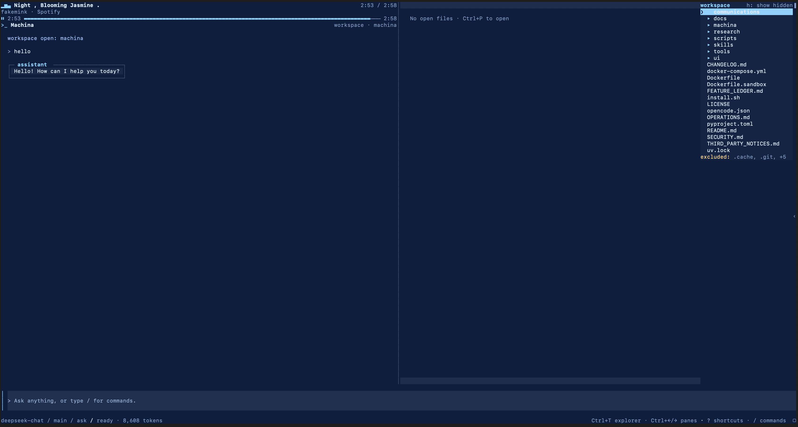
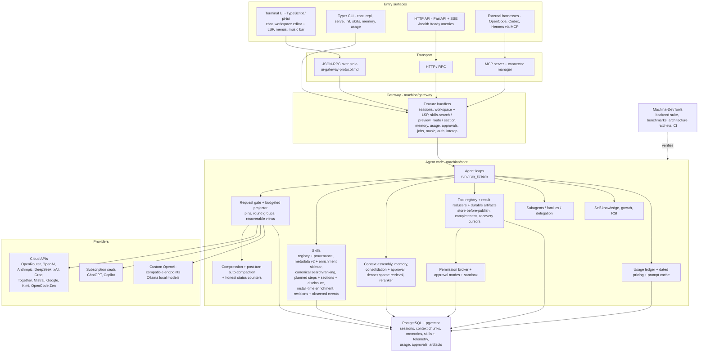

# Machina



A self-hosted, multi-agent AI orchestration framework: an agent with a terminal UI, PostgreSQL-backed conversations, memory and durable context, a tool registry with a permission broker, a skills system with deterministic routing, and a JSON-RPC gateway that the UI, the HTTP API, and external harnesses all speak to.

Machina runs against frontier APIs (OpenRouter, OpenAI, Anthropic, DeepSeek, xAI, Groq, Together, Mistral, Google, OpenCode Zen, Kimi), subscription seats (`chatgpt`, `copilot`), any OpenAI-compatible endpoint (`custom`), and local models (`ollama`). State — sessions, context chunks, memories, skills, usage, approvals — lives in PostgreSQL, so it survives restarts and is shared across the CLI, the TUI, and the HTTP API.

**Status: `0.2.0` development release candidate.** Verified in this checkout: the budgeted request projector wired into both agent loops against a real DeepSeek turn ([docs/verification/DETERMINISTIC_SKILLS_B3_EVIDENCE.md](docs/verification/DETERMINISTIC_SKILLS_B3_EVIDENCE.md) §10) and the live macOS now-playing bar (real PTY + gateway + detector, [docs/verification/NOWPLAYING_NATIVE_VERIFICATION.md](docs/verification/NOWPLAYING_NATIVE_VERIFICATION.md)). **Environment-gated / unverified:** native Anthropic/OpenAI signed-block replay at the provider transport (`DETERMINISTIC_SKILLS_B3_EVIDENCE.md` §73, §116), hosted CI runs, and any live-provider quality or performance claim — fixture tests are not evidence of model quality. There is **no Python test suite in this repository**; the backend suite lives in the sibling [Machina-DevTools](../Machina-DevTools) checkout.

## How it fits together

End-to-end view of the surfaces, transport, gateway, agent core, provider layer, and storage (GitHub renders this diagram; the second screenshot is [docs/screenshot.png](docs/screenshot.png)).



## Contents

- [How it fits together](#how-it-fits-together)
- [Highlights](#highlights)
- [Requirements](#requirements)
- [Install](#install)
- [Quickstart](#quickstart)
- [The terminal UI](#the-terminal-ui)
- [Skills system](#skills-system)
- [Rolling context & token efficiency](#rolling-context--token-efficiency)
- [Memory & retrieval](#memory--retrieval)
- [Providers & models](#providers--models)
- [Configuration](#configuration)
- [Gateway & integrations](#gateway--integrations)
- [Security & permissions](#security--permissions)
- [Testing & development](#testing--development)
- [Repository layout](#repository-layout)
- [Docs map](#docs-map)
- [Troubleshooting](#troubleshooting)
- [License & credits](#license--credits)

## Highlights

Each item below is grounded in the tree, not aspirational.

- **One backend, three front doors.** A Python CLI (`machina`, [machina/cli/__init__.py](machina/cli/__init__.py)), a TypeScript terminal UI ([ui/src/main.ts](ui/src/main.ts)), and a FastAPI HTTP server ([machina/api/app.py](machina/api/app.py)) share the same core services. The TUI and HTTP API both drive the agent through the same JSON-RPC gateway ([machina/gateway/server.py](machina/gateway/server.py)).
- **40+ CLI commands** for chat, sessions, memory, skills, usage, config, providers, growth, harness interop — see [the command surface](#cli-command-surface).
- **35 built-in agent tools** (file I/O, terminal, web search/crawl/extract/research, RAG indexing, memory, skills, artifacts, repo staging, delegation, MCP), registered in [machina/tools/__init__.py](machina/tools/__init__.py).
- **Integrated code workspace** in the TUI: editor with file tabs, right-edge explorer, problems pane, Quick Open, and optional Python/TypeScript language intelligence via real LSP servers ([docs/design/WORKSPACE.md](docs/design/WORKSPACE.md)).
- **Rolling context with durable evidence.** Oversized tool results are stored verbatim as session-scoped artifacts with re-authorized, paged recovery; deterministic reducers shrink them; a budgeted request projector plans the model-visible view ([docs/TOKEN_EFFICIENCY.md](docs/TOKEN_EFFICIENCY.md)).
- **Deterministic skills routing.** A provenance-aware registry, schema-v2 catalog metadata with bounded diagnostics, a conflict-free selector, and stage-aware instruction disclosure ([machina/skills/](machina/skills/); catalog RPCs in [communications/ui-gateway-protocol.md](communications/ui-gateway-protocol.md)).
- **Permission broker, not ad-hoc prompts.** Every execution path is evaluated against declared effects, with exact action digests, decision/execution separation, and execution modes `ask | workspace | sandbox | full` ([SECURITY.md](SECURITY.md)).
- **Human-in-the-loop everywhere it matters:** approval cards in the TUI, `POST /api/v1/approvals/{id}/resolve|resume`, and memory approve/reject gates.
- **Runtime learning, bounded and revertible:** persona notes, growth episodes, a bounded RSI loop, and post-turn learned skills with an auto-apply cap and a revert path.

## Requirements

| Component | Requirement | Source |
|---|---|---|
| Python | **3.11+** | `pyproject.toml` `requires-python` |
| PostgreSQL | **16+ with pgvector** | [docker-compose.yml](docker-compose.yml), install help |
| Node.js | **≥ 22.19** (TUI only) | `ui/package.json` `engines`, [machina/cli/launcher.py](machina/cli/launcher.py) |
| Optional Python extras | `secrets`, `connectors`, `embeddings-local`, `embeddings-onnx`, `rerank`, `workflow-trial`, `dev` | `pyproject.toml` |

The base install runs **keyword-only** retrieval: dense embeddings and cross-encoder reranking are opt-in extras (see [Memory & retrieval](#memory--retrieval)). The backend wheel installs the CLI, gateway, bundled skills, and Docker-side HTTP API, but **not** Node dependencies or the TUI.

## Install

### One-command installer

[install.sh](install.sh) reuses a checkout or clones one, creates a Python virtual environment, installs backend and UI dependencies, creates/fills `.env`, runs `machina init`, and installs a `machina` launcher on your `PATH`. On `init` failure it tries to provision local pgvector Postgres (Docker, then Homebrew on macOS) unless told otherwise.

```bash
# Zero-friction install from anywhere (clones the repo, creates .venv, installs
# backend + UI deps, fills .env, runs init, bootstraps local Postgres if needed,
# and puts `machina` on your PATH):
curl -fsSL https://raw.githubusercontent.com/kiazh/Machina-Harness/main/install.sh | bash

# With options (the `--` separates bash's args from the script's flags):
curl -fsSL https://raw.githubusercontent.com/kiazh/Machina-Harness/main/install.sh | bash -s -- --dir ~/machina --dev
curl -fsSL https://raw.githubusercontent.com/kiazh/Machina-Harness/main/install.sh | bash -s -- --interactive

# From a checkout you already have:
bash install.sh

# Options (see `bash install.sh --help`):
#   --dir DIR            install directory (default ./machina)
#   --dev                install Python dev extras
#   --no-ui              skip UI dependencies
#   --interactive        prompt for OPENROUTER_API_KEY even when piped
#   -y, --yes            non-interactive
#   --with-docker-db     force Docker Postgres on init failure
#   --no-docker-db       never use Docker Postgres
#   --no-auto-db         never auto-provision Postgres (Docker or Homebrew)
#   --no-shell-rc        don't edit shell rc files; print a PATH hint
#   --skip-init          skip automatic `machina init`
```

It supports macOS/Linux and Git Bash on Windows.

### Manual source install

```bash
git clone <your-fork-or-checkout-url> machina && cd machina
python3 -m venv .venv && source .venv/bin/activate
pip install -e ".[dev]"                 # add extras as needed, e.g. ".[dev,connectors,embeddings-onnx,rerank]"
npm ci --ignore-scripts --prefix ui     # TUI dependencies (Node 22.19+)
cp .env.example .env                    # fill in DATABASE_URL and provider keys
machina setup                           # interactive first-run configuration
machina init                            # create the database schema
machina doctor                          # check prerequisites, keys, DB health
```

Local skill installs and learned skills read `MACHINA_SKILLS_DIR` / `MACHINA_LEARNED_SKILLS_DIR` when overridden; otherwise they are discovered from the package. The TUI directory can be pointed at with `MACHINA_UI_DIR` for non-editable wheel installs.

### Docker (HTTP backend)

[docker-compose.yml](docker-compose.yml) starts `pgvector/pgvector:pg16` plus the app container, which runs `machina init && exec machina serve --host 0.0.0.0 --port 8000`. Provider keys and `MACHINA_API_KEY` are forwarded from the host environment.

```bash
export MACHINA_API_KEY="$(openssl rand -hex 32)"   # required by compose
docker compose up -d
# HTTP API on 127.0.0.1:8000; health: GET /ready
```

The app container is read-only, drops all capabilities, and only exposes a writable `~/.machina` volume. [Dockerfile.sandbox](Dockerfile.sandbox) builds the separate `machina-tool-sandbox:latest` image for `execution_mode: sandbox` / `terminal_sandbox: docker`:

```bash
docker build -f Dockerfile.sandbox -t machina-tool-sandbox:latest .
```

### Environment file

Secrets belong in `.env` (git-ignored) or a supported secret backend — never in `~/.machina/config.yaml`. `.env.example` documents the variable names; notable groups:

| Group | Variables (names only) |
|---|---|
| Database | `DATABASE_URL`, `MACHINA_TEST_DATABASE_URL` |
| Default model | `MACHINA_MODEL`, `MACHINA_PROVIDER` |
| Provider keys | `OPENROUTER_API_KEY`, `OPENAI_API_KEY`, `ANTHROPIC_API_KEY`, `GOOGLE_API_KEY`, `MISTRAL_API_KEY`, `GROQ_API_KEY`, `TOGETHER_API_KEY`, `DEEPSEEK_API_KEY`, `XAI_API_KEY`, `OPENCODE_API_KEY`, `KIMI_API_KEY`, `COHERE_API_KEY`, `CUSTOM_API_KEY`, `CUSTOM_BASE_URL` |
| HTTP / provenance | `MACHINA_API_KEY`, `MACHINA_PROVENANCE_KEY` |
| Embeddings / rerank | `MACHINA_EMBEDDING_BACKEND`, `MACHINA_EMBEDDING_MODEL`, `MACHINA_EMBEDDING_BASE_URL`, `MACHINA_RERANKER_BACKEND`, `MACHINA_RERANKER_HTTP_URL`, `MACHINA_RRF_KEYWORD_WEIGHT`, `MACHINA_RRF_DENSE_WEIGHT` |
| Budgets | `MACHINA_USAGE_SESSION_TOKEN_LIMIT`, `MACHINA_USAGE_SESSION_REQUEST_LIMIT`, `MACHINA_USAGE_AGENT_TOKEN_LIMIT`, `MACHINA_USAGE_AGENT_REQUEST_LIMIT` |
| Learning / memory | `MACHINA_PERSONA_MEMORY_ENABLED`, `MACHINA_PERSONA_DEFAULT_EMOTION`, `MACHINA_LEARNING_REVIEW_AUTO_APPLY`, `MACHINA_LEARNING_REVIEW_AUTO_APPLY_PER_DAY`, `MACHINA_LEARNED_SKILLS_DIR` |
| Ops | `MACHINA_WORKSPACE_ROOT`, `MACHINA_SCRIPTS_DIR`, `MACHINA_TURN_TIMEOUT`, `MACHINA_APPROVAL_TIMEOUT`, `MACHINA_HTTP_RATE_LIMIT`, `SEARXNG_URL` |

Value precedence: session override → `MACHINA_<KEY>` → legacy provider env var → mounted secret file → secret backend → non-secret YAML → default (`.env.example`).

## Quickstart

### 1. One-shot chat

```bash
machina chat "Summarize the repository layout"
machina chat -c "Continue from the last session"     # -c/--continue
machina chat -s <session-id> "Resume this session"   # -s/--session
machina chat -m deepseek-chat -p deepseek "Hello"    # override model/provider
```

Headless exit codes (`machina chat --help`): `0` completed, `1` failed (including a session already busy with a live turn), `3` paused for an approval decision, `130` interrupted.

### 2. Interactive UI

```bash
machina          # no subcommand opens the TUI
machina repl     # same UI, explicitly
machina chat -i  # same UI
```

`machina`, `machina repl`, and `machina chat -i` all call the launcher ([machina/cli/launcher.py](machina/cli/launcher.py)), which checks Node ≥ 22.19, requires a real TTY, generates a per-run `MACHINA_GATEWAY_TOKEN`, and spawns `node ui/src/main.ts` (which itself spawns `python -m machina.gateway`).

### 3. HTTP server

```bash
export MACHINA_API_KEY="$(openssl rand -hex 32)"
machina serve --host 127.0.0.1 --port 8000
# or: machina serve --reload
```

Routes under `/api/v1` (sessions, memory, documents, jobs, approvals, models, plus `POST /rpc`), with `/health` and `/ready` unauthenticated and `/metrics` requiring the API key.

### CLI command surface

`python -m machina --help` lists the top-level commands. Selected groups:

```text
Session    status, sessions, sessions-search, export, fork, delete, context, compress
Chat       chat, repl, serve
Skills     skills, learn, curator, hub
Memory     memory-list, memory-search, memory-forget, memory-pending,
           memory-approve, memory-reject, memory-approve-all, memory-reject-all, memory-stats
Persona    user-profile, user-profile-update, user-profile-list, growth
Providers  providers, auth, models via the TUI/gateway
Setup      setup, init, doctor, config, config-set, version, uninstall, mode, usage
Interop    harnesses (alias: interop)
```

`machina repl` accepts `--model/-m`, `--provider/-p`, `--session/-s`, and `--mode`; bare `machina` accepts the global `--mode` flag (`ask|workspace|sandbox|full`), which also applies to one-shot commands.

## The terminal UI

The TUI is a Node program built on `@earendil-works/pi-tui` (`ui/package.json`, dependency pinned at `1.0.0`). It launches the Python gateway over JSON-RPC on stdio. Render the command palette with `/help` (searchable; group order in [ui/src/commands.ts](ui/src/commands.ts)).

### Slash commands

`/help` opens the searchable palette; the same command set is grouped as:

| Group | Commands |
|---|---|
| Session | `/new` `/resume` `/sessions` `/search` `/recall` `/rename` `/fork` `/delete` `/export` `/clear` |
| Task | `/goal` `/review` `/init` `/delegate` `/agents` |
| Workspace | `/workspace` `/editor` `/explorer` `/lsp` `/problems` `/quickopen` |
| Memory | `/memory` `/growth` `/persona` `/skills` |
| Context | `/context` `/compress` |
| Automation | `/jobs` |
| Setup | `/auth` `/keys` `/models` `/default-model` `/provider` `/effort` `/config` `/theme` `/profile` `/profiles` `/mode` `/approvals` `/interop` `/harnesses` |
| Info | `/status` `/usage` `/output` `/mcp` `/help` `/exit` |

Aliases resolve in [ui/src/commands.ts](ui/src/commands.ts) (`settings`→`config`, `skill`→`skills`, `model`→`default-model`, `providers`→`provider`, `compact`→`compress`, …).

- **`/skills`** — opens the interactive skills directory (browse / list / search / show / learn / proposals / approve / reject / revert / delete / curator). See [Skills system](#skills-system).
- **`/settings`** — global editor preferences (syntax highlighting, soft wrap, tab width), stored as the bounded `ui_preferences` JSON document; also surfaces Appearance (theme, transparent background) and workspace rows.
- **`/theme`** — preview one of **53 palettes** live; arrows preview, Enter saves, Escape restores. Persisted through the single `config.theme` path.
- **`/workspace`** — `open <path>` / `split` / `chat` / `editor` / `ratio` / `side` / `status` / `close`; creates the backend-issued workspace identity.
- **`/music`** — now-playing status and transport (`nowplaying.get` / `nowplaying.command` behind the bar).

### Keybindings

From the `?` / F1 shortcut picker ([ui/src/app.ts](ui/src/app.ts) `shortcutItems`):

| Key | Action |
|---|---|
| `Enter` | Send a message / run a command |
| `Shift+Enter` | New line |
| `Ctrl+V` (or drop an image) | Paste image (PNG/JPEG/GIF/WebP) |
| `Esc` | Stop reply; twice on empty input edits the last prompt |
| `Ctrl+C` | Stop reply / clear draft / exit when empty |
| `Ctrl+D` | Exit (idle + empty input) |
| `Ctrl+L` | Clear chat (idle) |
| `Tab` | Complete commands and arguments |
| `↓` | Subagent menu (empty input) |
| `Ctrl+Shift+←/→` | Switch between main session and subagents |
| `Ctrl+P` | Quick Open (fuzzy file search) |
| `Ctrl+S` | Save active editor buffer |
| `Ctrl+W` | Close active editor tab (dirty → save/discard/cancel) |
| `Ctrl+T` | Toggle right-edge file explorer |
| `Ctrl+Space` | Completion (macOS may steal it; fallback `/editor complete`) |
| `F12` / `Shift+F12` / `F2` | Definition / references / rename preview |
| `F6` / `Shift+F6` | Cycle focus: composer → editor → explorer → problems |
| `Ctrl+→` / `Ctrl+←` | Maximize chat / return to 50/50 split (editor focus) |
| `?` / `F1` | Keyboard-shortcuts picker |
| `□` / `▪` | Activity + learning indicator (bottom-right pulse) |

### Integrated editor, LSP, problems, Quick Open

The workspace is a separate event family from chat and never enters the transcript reducer. The UI talks to it through `workspace.*` gateway methods ([communications/ui-gateway-protocol.md](communications/ui-gateway-protocol.md)). From [docs/design/WORKSPACE.md](docs/design/WORKSPACE.md):

- Default split at ≥ 89 columns: chat left, workbench right (~50/50); collapse to one pane below the minimum and restore automatically.
- Tabs are preview (single click) vs pinned (double click); dirty/conflict/read-only states are labelled in text, not only color.
- **Save is compare-and-swap** (`sha256-hex[0:32]:<size-bytes>` revisions); conflicts prompt Reload / Overwrite / Keep editing — unsaved buffers are never silently replaced.
- **Two LSP profiles** out of the box: `pyright-langserver --stdio` (Python) and `typescript-language-server --stdio` (TS/JS). A missing server is reported honestly (`missing`); nothing is auto-installed.
- `workspace.intelligence` is a closed allowlist (`completion`, `hover`, `definition`, `references`, `symbols`, `diagnostics`), never a raw LSP tunnel.
- Opening or viewing a file never sends its contents to the model; content reaches chat only through the explicit `/attach` selection flow.
- `MACHINA_WORKSPACE=0` disables the workspace entirely (chat-only app).

**Terminal split note:** there is no in-app terminal pane in the workspace. The `terminal` tool is a separate agent tool (sandboxable via `terminal_sandbox` / `execution_mode: sandbox`).

### Now-playing bar

A pinned bar shows what is playing on this machine, from any app (browser video, Spotify, Music, …). Detection is layered and local ([machina/core/nowplaying.py](machina/core/nowplaying.py)): MediaRemote (private framework, silent-empty when gated), `nowplaying-cli`/`media-control` if installed, Spotify/Music via AppleScript, then a Chromium/Safari YouTube tab. Metadata never leaves the machine.

**macOS Automation permission is real.** The first AppleScript query (layers 3–4) triggers the standard Automation prompt; while unanswered, the layer times out and an explicit denial is reported as a named `permission` state. On the verified machine, Spotify was already authorized (layer 3 reached permission-free) and MediaRemote was gated; the browser layer (layer 4) would prompt, so it was shimmed off during verification. See [docs/verification/NOWPLAYING_NATIVE_VERIFICATION.md](docs/verification/NOWPLAYING_NATIVE_VERIFICATION.md). Hide the bar with `/music off` or `nowplaying_enabled: false`.

## Skills system

Skills are `SKILL.md` instruction packages. The registry ([machina/skills/registry.py](machina/skills/registry.py)) discovers them, tracks provenance, and does a best-effort injection scan (NFKC folding, invisible characters, homoglyphs, leetspeak, base64 blobs) — explicitly **one layer of defense, never a security boundary**.

- **Built-in catalog.** The repo ships 34 first-party skills under [skills/](skills/) plus a curated **42-skill ECC bundle** under `skills/ecc/` ([docs/ECC_SKILLS.md](docs/ECC_SKILLS.md)). Both are packaged into the wheel (`packages = ["machina", "skills"]`).
- **Deterministic selector.** Ranking and explanations live in [machina/skills/search.py](machina/skills/search.py); task routing and stage-aware disclosure in [machina/skills/runtime.py](machina/skills/runtime.py) and [machina/skills/planned_steps.py](machina/skills/planned_steps.py). A `TaskDescriptor` selects skills and produces stable planned-step ids; the disclosure plan serves chosen sections and prerequisites keyed by revision identities.
- **Metadata schema v2.** Authored front matter and bundled sidecars parse into an inert `SkillMetadata` object ([machina/skills/metadata.py](machina/skills/metadata.py)). v1 front matter is untouched; unknown fields are preserved as opaque data; authority-shaped field names are dropped; closed vocabularies (task families, capabilities, stages) reject unknown values with bounded diagnostics; cycles/over-depth dependency graphs reject the whole metadata.
- **ECC enrichment sidecar.** [machina/skills/enrichment/`<revision>`.json](machina/skills/enrichment/) holds local routing enrichment for bundled ECC content, keyed by skill id and bound to the bundle revision — a mismatch yields `stale-enrichment` and baseline fallback. Sidecars cannot alter provenance/trust or grant permissions.
- **Install-time, once-only metadata generation.** A freshly installed or learned skill (a v1 `SKILL.md` with no metadata) gets one model-generated v2 metadata block merged into its front matter, preserving the body byte-for-byte ([machina/skills/enrich.py](machina/skills/enrich.py)). Because the persisted document then carries `schema_version`, later loads never regenerate. Generation is fail-open: an invalid answer or provider error leaves the skill as-is.
- **Catalog reads over the gateway.** `skills.search`, `skills.preview_route`, and `skills.section` provide bounded, call-free catalog reads (no model/embedding/tool/install). The native `skill_read` tool gained optional `section`/`revision` parameters with the same semantics; legacy offset reads stay byte-identical ([communications/ui-gateway-protocol.md](communications/ui-gateway-protocol.md)).
- **`/skills` UX.** `/skills`, `/skills list`, and `/skills search` open the interactive directory; hosts without that surface fall back to the bounded `skills.search` table.

## Rolling context & token efficiency

Machina keeps durable state and sends a *planned* view, never a destructive rewrite. Full contract: [docs/TOKEN_EFFICIENCY.md](docs/TOKEN_EFFICIENCY.md); operational evidence: [docs/verification/TOKEN_EFFICIENCY_2026-10-16.md](docs/verification/TOKEN_EFFICIENCY_2026-10-16.md).

- **Durable artifacts (on; fail-open).** Oversized tool results are stored verbatim *before* any lossy view is published ([machina/core/artifacts.py](machina/core/artifacts.py)). Recovery is re-authorized through the session delegation tree via `artifact_read` (character paging with true totals), `artifact_search`, and `artifact_describe`. Every record carries an honest **completeness** flag (`complete` / `upstream_truncated` / unknown, never silently complete), and paged reads/searches use **bound cursors** that pin the source revision and retention observed at issue time. Store failure/quota/oversize falls back to the legacy append cap with no recovery claim. Retention: `artifact_retention_days` (default 30, `0` = no expiry), `artifact_max_per_session`, `artifact_max_chars`.
- **Deterministic reducers (on; fail-open).** [machina/core/reducers.py](machina/core/reducers.py) turns over-cap results into bounded, dense views — tests/logs/JSON/CSV/diff/code outlines, with a head+tail fallback whose omission seam is marked. A reduced view is published only when the exact original was durably retained first; parse failure or no net saving keeps the original behavior. View construction and disclosure of recovery handles live in [machina/core/tool_views.py](machina/core/tool_views.py).
- **Budgeted request projector.** [machina/core/request_projection.py](machina/core/request_projection.py) plans the model-visible request: pins are never truncated, provider-required/protected (native/signed) blocks are preserved, tool-call batches stay atomic, and bulky older observations are replaced by verified views only when the artifact lookup reports `available` and `complete`. The gate that invokes it is [machina/core/request_gate.py](machina/core/request_gate.py).
- **`request_projection_enabled` (default `true`).** When on, both live loops (`run()` and `run_stream()`) send the projected payload. Verified against a real `deepseek/deepseek-chat` turn (`run()` and `run_stream()` accepted the projected payload — pins-first system messages plus verified `[machina view: …]` units), see [docs/verification/DETERMINISTIC_SKILLS_B3_EVIDENCE.md](docs/verification/DETERMINISTIC_SKILLS_B3_EVIDENCE.md) §10. When off, projection reverts to shadow-only (bounded comparison log; outgoing payloads byte-identical). **Not verified:** native signed-block replay at a real Anthropic/OpenAI transport (`DETERMINISTIC_SKILLS_B3_EVIDENCE.md` §73, §116).
- **Evidence projection (on; fail-open).** [machina/core/projection.py](machina/core/projection.py) removes exact duplicates across memory/RAG/archive excerpts, then keeps entries in priority order until `retrieval_token_budget` (default 6000) is spent; omissions are disclosed in the prompt (`[N lower-ranked retrieved excerpts omitted by the token budget]`), and the first entry always survives.
- **Usage ledger (always on).** One accounting path ([machina/core/usage.py](machina/core/usage.py), `llm_usage` table) normalizes prompt tokens as `uncached + cache_read + cache_write` (missing ≠ zero) and records the basis, task purpose, session/agent ancestry, cost, and accepted-completion marker. Prices come from dated snapshots ([machina/core/pricing.py](machina/core/pricing.py)); unknown models keep NULL cost, and overrides are extendable via `pricing_table_json`. Inspect with `machina usage`.
- **Prompt cache (opt-in, default off).** `prompt_cache_enabled` attaches Anthropic-style ephemeral `cache_control` breakpoints to stable-prefix ends; unknown providers are treated as unsupported until verified (capability profiles in [machina/core/provider/prompt_cache.py](machina/core/provider/prompt_cache.py)). Off-path payloads are byte-identical.

Deliberately **not enabled** (no task-specific evidence yet, per the plan doc): learned compression/LLMLingua-style pruning, model routing/reasoning-effort adaptation, semantic answer caching, cache warmers, and progressive native-tool schema deferral.

## Memory & retrieval

- **What persists.** Memory entries, persona notes, user profiles, consolidation decisions, and RAG documents/chunks all live in PostgreSQL ([machina/memory/](machina/memory/), [machina/rag/](machina/rag/)). Memory content is secret-redacted before storage; a fail-closed marker replaces text that could not be redacted.
- **Consolidation & approval.** Conversations are consolidated into candidate memories by extracting → importance-scoring → dedup → write ([machina/memory/consolidator.py](machina/memory/consolidator.py)). With `memory_approval_enabled` (default **off**), writes route to a pending queue for human approve/reject (CLI `memory-pending`/`memory-approve`/`memory-reject`, or the `/memory` menu); with it off, writes are durable directly. Typed consolidation outcomes (`complete`/`empty`/`partial`/`failed`) drive retryable checkpoints.
- **Persona-conditioned retrieval** is on by default (`persona_memory_enabled: true`, `persona_default_emotion: trust`) and stores user preferences separately from agent lessons.
- **Retrieval ranking.** [machina/memory/retriever.py](machina/memory/retriever.py) merges dense and sparse (keyword) candidates, demotes catalog/echo content (never drops it), and uses recency/importance only to break ties. Hybrid fusion uses reciprocal-rank weights `rrf_keyword_weight` (1.0) and `rrf_dense_weight` (0.25); weights apply only when dense retrieval is enabled.
- **Dense/sparse + reranking are opt-in.** Default `embedding_backend: "off"` (keyword-only) and `reranker_backend: "none"`. Enable dense with `onnx` (in-process fastembed), `local` (static model2vec, pure NumPy), `openai`, or `auto` (explicit endpoint → ONNX → model2vec → OpenAI/OpenRouter keys). Enable reranking with `local` (ONNX cross-encoder), `cohere`, or `http` (a `llama-server --reranking` endpoint). These require the matching extras (`embeddings-onnx`, `embeddings-local`, `rerank`).
- **RAG indexing.** [machina/rag/](machina/rag/) handles ingestion, chunking, embedding, and search; the agent tools `index_document` and `search_documents` are session-scoped, and `web_crawl` indexes bounded multi-page crawls into session RAG.
- **Forgetting / RSI / growth.** `machina/memory/forgetting.py`, `rl.py`, `rsi.py`, and `growth.py` back the `growth` commands and gateway methods; growth is enabled by default and reversible.

## Providers & models

The provider registry is in [machina/core/provider/specs.py](machina/core/provider/specs.py) (`PROVIDER_SPECS`, `PROVIDERS`, `provider_names`) and the factory in [machina/core/provider/factory.py](machina/core/provider/factory.py).

| Provider | Key / auth | Default model | Notes |
|---|---|---|---|
| `openrouter` | `OPENROUTER_API_KEY` | `openrouter/free` | multi-model gateway (default) |
| `openai` | `OPENAI_API_KEY` | `gpt-4o-mini` | |
| `deepseek` | `DEEPSEEK_API_KEY` | `deepseek-chat` | |
| `xai` | `XAI_API_KEY` | `grok-4` | |
| `groq` | `GROQ_API_KEY` | `llama-3.3-70b-versatile` | |
| `together` | `TOGETHER_API_KEY` | `meta-llama/Llama-3.3-70B-Instruct-Turbo` | |
| `mistral` | `MISTRAL_API_KEY` | `mistral-small-latest` | |
| `google` | `GOOGLE_API_KEY` | `gemini-2.0-flash` | OpenAI-compat endpoint |
| `opencode` | `OPENCODE_API_KEY` | `big-pickle` | OpenCode Zen gateway; override with `OPENCODE_BASE_URL` |
| `kimi` | `KIMI_API_KEY` | `kimi-for-coding` | Kimi Code |
| `anthropic` | `ANTHROPIC_API_KEY` | `claude-3-5-sonnet-20241022` | native Anthropic API |
| `chatgpt` | `machina auth` (Codex OAuth) | live per-account catalog | no API key |
| `copilot` | `machina auth` (GitHub device flow) | — | no API key |
| `custom` | `CUSTOM_BASE_URL` (+ optional `CUSTOM_API_KEY`) | your model id | any OpenAI-compatible endpoint; keyless supported |
| `ollama` | none | `llama3.1` | local models |

- **Adding a provider.** `machina providers` manages user-added OpenAI-compatible providers (name + base URL + optional key); the catalog is pulled from `GET {base}/models`. Gateway methods `providers.list|add|remove` and `models.list|setEffort` back the `/provider` and `/models` menus; keys are written to git-ignored `.env`, never to the JSON store.
- **Reasoning effort.** `reasoning_effort` accepts `low|medium|high` wire-wide plus catalog tiers (`minimal|xhigh|max` for validated ChatGPT models); unsupported tiers are ignored per provider.
- **Streaming usage.** Provider transports normalize usage blocks across Anthropic, OpenAI-compatible, DeepSeek, ChatGPT, Copilot, and OpenRouter ([machina/core/provider/usage_map.py](machina/core/provider/usage_map.py)).
- **Serving.** There is no in-repo model server; the HTTP API serves agent turns (`machina serve`), and `custom`/`ollama` point at your own inference stack.

## Configuration

Config file: **`~/.machina/config.yaml`** (`DEFAULT_CONFIG_PATH` in [machina/core/config.py](machina/core/config.py)). Environment variables (`MACHINA_<KEY>`) override file values; secrets always resolve from the environment/backend, never the file. View and set values with `machina config` / `machina config-set`, or the TUI `/config`/`/settings`.

Curated keys (defaults from `DEFAULTS` in [machina/core/config.py](machina/core/config.py)):

| Key | Default | Meaning |
|---|---|---|
| `model` | `openrouter/free` | active model id |
| `provider` | `openrouter` | active provider |
| `temperature` | `0.7` | sampling temperature (0–2) |
| `max_tokens` | `4096` | output ceiling (≤ 32768) |
| `reasoning_effort` | `""` | provider default; `low\|medium\|high` (+ catalog tiers) |
| `execution_mode` | `ask` | `ask \| workspace \| sandbox \| full` |
| `turn_timeout` | `300` | seconds per turn |
| `approval_timeout` | `300` | seconds to wait for an approval |
| `rate_limit_calls_per_minute` | `10` | throttle (0 = off) |
| `streaming` | `true` | stream provider output |
| `theme` | `codex` | UI skin |
| `transparent_background` | `false` | render on the terminal's own background |
| `nowplaying_enabled` | `true` | show the now-playing bar |
| `ui_preferences` | `""` | bounded JSON: editor prefs (syntax highlight, soft wrap, tab width) |
| `workspace_ui_state` | `""` | bounded JSON: per-root layout/URIs/cursors |
| `compression_enabled` | `true` | context compression |
| `compression_threshold` / `compression_target_ratio` | `0.8` / `0.5` | when to compress / target size |
| `compression_preserve_recent` | `3` | recent chunks kept |
| `auto_compaction_enabled` | `true` | automatic compaction |
| `eviction_max_tokens` | `0` | eviction ceiling (0 = unlimited) |
| `artifacts_enabled` | `true` | durable artifacts + recovery tools |
| `artifact_retention_days` | `30` | `0` = no expiry |
| `artifact_max_per_session` | `500` | quota refuses, never evicts |
| `artifact_max_chars` | `2000000` | larger results keep legacy truncation |
| `reducers_enabled` | `true` | format reducers for over-cap results |
| `request_projection_enabled` | `true` | wire the budgeted request projector |
| `retrieval_selection_enabled` | `true` | dedup + budgeted evidence selection |
| `retrieval_token_budget` | `6000` | `0` disables the budget |
| `output_policy` | `legacy` | `legacy` or `concise` |
| `prompt_cache_enabled` | `false` | capability-gated prompt-cache pilot |
| `embedding_backend` | `off` | `auto\|local\|onnx\|openai\|off` |
| `reranker_backend` | `none` | `auto\|local\|cohere\|http\|none` |
| `rrf_keyword_weight` / `rrf_dense_weight` | `1.0` / `0.25` | hybrid fusion |
| `memory_enabled` | `true` | long-term memory |
| `memory_approval_enabled` | `false` | route writes through approve/reject |
| `memory_consolidation_enabled` | `true` | extract memories from turns |
| `persona_memory_enabled` | `true` | persona-conditioned retrieval |
| `personality_growth_enabled` / `rsi_enabled` | `true` / `true` | runtime learning |
| `learning_review_auto_apply` | `true` | publish learned skills within caps |
| `learning_review_auto_apply_per_day` | `5` | rolling 24h cap (0 = stage-only) |
| `skills_disclosure_planner` | `true` | stage-aware instruction disclosure |
| `rag_enabled` | `true` | document RAG |
| `usage_session_token_limit` / `usage_agent_token_limit` | `0` / `0` | lifetime budgets (0 = unlimited) |

`pricing_table_json` holds optional per-provider price overrides; `firecrawl_autostart` / `firecrawl_stop_on_exit` / `firecrawl_home` control the opt-in Firecrawl/SearXNG stack lifecycle for the UI (off by default).

## Gateway & integrations

The UI and HTTP API share one authenticated **JSON-RPC 2.0** gateway ([machina/gateway/server.py](machina/gateway/server.py), feature families in [machina/gateway/features/](machina/gateway/features/)). The protocol, events, and every method family are specified in [communications/ui-gateway-protocol.md](communications/ui-gateway-protocol.md) (event schema source of truth: `machina/protocol/events.json`, version 2).

Core and feature method families:

| Family | Methods (examples) |
|---|---|
| Core | `initialize`, `session.create/list/resume`, `prompt.submit/cancel`, `usage.get`, `config.get/set`, `shutdown` |
| Session | `session.delete/export/fork/recall/rename/search/setGoal/setModel` |
| Mode & approvals | `mode.get/set/revoke`, `approvals.list/resolve` |
| Memory & growth | `memory.*`, `profile.*`, `growth.*` |
| Skills | `skills.list/show/search/section/preview_route/learn/delete/curator` |
| Workspace | `workspace.open/list/read/save/document*/quickOpen/quickOpenCancel/intelligence/lsp*/close` |
| Connectors & providers | `mcp.*`, `models.list/setEffort`, `providers.list/add/remove` |
| Ops | `jobs.*`, `agents.*`, `secrets.*`, `nowplaying.get/command`, `interop.*` |

- **Events.** Gateway notifications use method `event` with the event in `params`; HTTP uses SSE (`data:` frames, `[DONE]` on normal retirement). Every v2 event carries `protocolVersion: 2`, `type`, `sessionId`, `turnId`.
- **Standalone gateway.** `python -m machina.gateway` mints a token and prints it to stderr when `MACHINA_GATEWAY_TOKEN` is unset ([SECURITY.md](SECURITY.md)).
- **HTTP API.** FastAPI routes under `/api/v1` plus `POST /rpc` ([machina/api/routes/](machina/api/routes/)): sessions, chat/prompt, context, usage, memory, documents, jobs, approvals (`resolve`/`resume`), models/agents. `/health` and `/ready` are unauthenticated; everything else, including `/metrics`, requires the `MACHINA_API_KEY` bearer.
- **MCP.** Part of the default backend (`mcp==2.3.0`): `mcp.configure/remove/preview/connect/disconnect/tools` plus read-only `mcp.list/status`, and native `mcp_list`/`mcp_describe`/`mcp_call` agent tools. Streamable-HTTP OAuth (Authorization Code + S256 PKCE) is implemented locally. See [docs/MCP.md](docs/MCP.md) and [docs/MCP_OAUTH.md](docs/MCP_OAUTH.md).
- **External harness interop.** `machina harnesses` (alias `machina interop`) detects and registers Machina's MCP server with OpenCode/Codex/Hermes, and can delegate one bounded prompt into a harness. Gateway methods `interop.list/enable/disable/run`.

## Security & permissions

Full model and trust boundaries: [SECURITY.md](SECURITY.md) and [docs/design/WORKSPACE_SECURITY.md](docs/design/WORKSPACE_SECURITY.md).

- **Execution modes.** New sessions snapshot the configured default (`ask`). `ask`/`workspace` approve routine project reads/writes, built-in web tools, retrieval, local Git, and common test/build/lint commands automatically, and require review for risky or unclassified effects. `sandbox` routes terminal execution through Docker. `full` issues an explicit session-scoped grant for no-approval host authority and is revocable (`/approvals revoke`); routing mode alone authorizes nothing.
- **The permission broker.** Every execution path (file/RAG/skill/terminal/jobs/delegation/plugins) goes through `PermissionBroker.guard` ([machina/permissions/broker.py](machina/permissions/broker.py)). Tools declare effects (`fs.read`, `fs.write`, `exec`, `net`, `memory`, `delegate`); the broker evaluates declared effects plus the exact action.
- **Exact approvals.** Action digest v2 binds tool, operation, mode, capabilities, canonical targets, argv/shell, cwd, backend, timeout, network declarations, content digest, and workspace identity. Decision and execution are separate atomic transitions; approval is consumed exactly once; changed actions require fresh approval; agent principals cannot resolve approvals.
- **Secrets.** Resolved through the environment, mounted files, or a Vault/AWS backend ([machina/security/](machina/security/)); `.env` writes validate names/content, reject newline injection, replace atomically, and use POSIX `0600`. Configured credential values are redacted on outbound paths, including streaming.
- **Scripts.** Script jobs require an administrator-owned `.script-policy.json` outside the agent workspace (allowlisted entry files + declared dependencies, hashed and re-checked before execution). Set `MACHINA_SCRIPTS_DIR` (docker-compose mounts `./scripts` read-only at `/app/scripts`).
- **Workspace trust.** Workspace identity is minted server-side; file access is resolved-path containment under the returned `resolvedRoot` (symlinks and `..` resolved and verified), never a textual prefix.

## Testing & development

**There is no Python test suite in this repository.** The backend suite and its runner live in the sibling **Machina-DevTools** checkout; `run-tests.sh` there resolves a Machina checkout via `$MACHINA_REPO` or a sibling directory, makes it importable through `PYTHONPATH`, and runs pytest under a disposable `HOME`/`MACHINA_HOME` so it never touches your config.

```bash
# From the Machina-DevTools checkout:
./run-tests.sh                       # uses ../machina or $MACHINA_REPO
MACHINA_REPO=/path/to/machina ./run-tests.sh tests/test_skill_runtime.py -q
```

The UI has its own Node test suite inside this repo ([ui/test/](ui/test/), run by `npm test`).

Local checks used in this repo (mirroring CI):

```bash
python -m ruff check machina/ tools/
python -m ruff format --check machina/ tools/
bandit -r machina/ -ll -x machina/cli/
uv lock --check
python -m hatchling build && python tools/check_release_artifacts.py dist/*
npm --prefix ui run check          # typecheck + tests + lint
```

CI ([.github/workflows/ci.yml](.github/workflows/ci.yml)) runs these as three jobs:

- **lint-and-test** — install `.[dev,connectors]`, `uv lock --check`, ruff check/format, bandit, build the wheel + sdist, verify wheel contents and isolated imports, upload distributions.
- **ui** — Node 24 + Python 3.11, a `pgvector/pgvector:pg16` service, schema init, `npm ci --ignore-scripts`, `npm audit`, then `npm run check` (including tests against a restarted real gateway).
- **docker** — builds the image and smoke-tests the CLI/`create_app`.

Architecture ratchets and layer/pair checks live in the DevTools suite (for example `test_architecture_layers.py`, `test_architecture_pairs.py`); their documented-delta expectations are cited in [docs/TOKEN_EFFICIENCY.md](docs/TOKEN_EFFICIENCY.md).

## Repository layout

```text
machina/            Python package (backend)
  cli/              Typer CLI and the TUI launcher
  core/             agent loop, context, compression, config, request projection/reducers,
                    artifacts, tool_views, usage, prompt, nowplaying, provider/
  api/              FastAPI app and per-resource routes
  gateway/          JSON-RPC gateway server + feature method families
  protocol/         canonical event schema (events.json) and TS codegen
  db/               asyncpg connection + schema
  memory/           memory store, consolidation, approval, persona, retriever, growth
  rag/              ingestion, chunking, embeddings, reranking, hybrid search
  skills/           registry, metadata v2, search, runtime, revisions, enrich, enrichment/
  tools/            built-in agent tool registry (35 tools)
  permissions/      broker, policy, shell, store
  security/         secret handling, auth (chatgpt/copilot), env files
  connectors/       MCP client, OAuth, HTTP transport
  workspace/        workspace file adapter and identity
  observability/    diagnostics, tracing, metrics, safe logging
  interop.py        external harness detection/registration/delegation
  bundled_agents/   core agents + bundled ECC subagents (71)
skills/             34 first-party skills + curated ECC bundle (42 skills in skills/ecc/)
ui/                 TypeScript terminal UI (src/) + Node tests (test/)
communications/     ui-gateway-protocol.md (protocol source of truth)
docs/               design/, verification/, and topical docs (see Docs map)
research/           example identity-scenario data
scripts/            host-side operator scripts mount point (README only by default)
tools/              repo-side tooling: release artifact checks, e2e gate, ECC vendoring
Dockerfile          backend HTTP image
Dockerfile.sandbox  terminal tool-sandbox image
docker-compose.yml  pgvector + app (HTTP backend)
install.sh          one-command installer
pyproject.toml      packaging, dependencies, optional extras, entry point
```

`FEATURE_LEDGER.md` and `CHANGELOG.md` record runtime/feature surfaces and release notes; `OPERATIONS.md` documents the deployment/recovery contract.

## Docs map

| Document | Contents |
|---|---|
| [SECURITY.md](SECURITY.md) | Trust boundaries, modes, exact approvals, secrets, failure semantics |
| [OPERATIONS.md](OPERATIONS.md) | Deployment, retention, monitoring, backup/restore contract |
| [communications/ui-gateway-protocol.md](communications/ui-gateway-protocol.md) | JSON-RPC events, negotiation, and every method family |
| [docs/TOKEN_EFFICIENCY.md](docs/TOKEN_EFFICIENCY.md) | Artifacts, reducers, projection, output policy, config keys |
| [docs/design/TUI_DESIGN.md](docs/design/TUI_DESIGN.md) | Terminal UI visual/interaction contract |
| [docs/design/THEME_COLORS.md](docs/design/THEME_COLORS.md) | The 53 palettes and color roles |
| [docs/design/WORKSPACE.md](docs/design/WORKSPACE.md) | Editor, explorer, problems, LSP, Quick Open, persistence |
| [docs/design/WORKSPACE_SECURITY.md](docs/design/WORKSPACE_SECURITY.md) | STRIDE threat model for the workspace feature |
| [docs/ECC_SKILLS.md](docs/ECC_SKILLS.md) | The 42-skill curated ECC bundle |
| [docs/ECC_AGENTS.md](docs/ECC_AGENTS.md) | The 71 bundled ECC subagents and tool mappings |
| [docs/MCP.md](docs/MCP.md) / [docs/MCP_OAUTH.md](docs/MCP_OAUTH.md) | MCP setup; Streamable-HTTP OAuth (PKCE) |
| [docs/PERMISSION_POLICY_REVIEW.md](docs/PERMISSION_POLICY_REVIEW.md) | The `ask`-mode risk policy |
| [docs/PERSONALITY_GROWTH.md](docs/PERSONALITY_GROWTH.md) | Persona, growth, and runtime self-improvement |
| [docs/SELF_IMPROVEMENT_PLAN.md](docs/SELF_IMPROVEMENT_PLAN.md) | The dogfooding self-improvement loop |
| [docs/verification/RELEASE_READINESS.md](docs/verification/RELEASE_READINESS.md) | Local 0.2.0 release-candidate review |
| [docs/verification/TOKEN_EFFICIENCY_2026-10-16.md](docs/verification/TOKEN_EFFICIENCY_2026-10-16.md) | Token-efficiency operational evidence |
| [docs/verification/DETERMINISTIC_SKILLS_B3_EVIDENCE.md](docs/verification/DETERMINISTIC_SKILLS_B3_EVIDENCE.md) | Wired request-projection release evidence |
| [docs/verification/NOWPLAYING_NATIVE_VERIFICATION.md](docs/verification/NOWPLAYING_NATIVE_VERIFICATION.md) | Native macOS now-playing verification |
| [docs/verification/](docs/verification/) | CI, codebase, RAG-quality, OAuth-risk, and workspace review records |

## Troubleshooting

| Symptom | Check |
|---|---|
| `machina init`/`serve` fails to connect | `DATABASE_URL` in `.env`; Postgres running with pgvector; then `machina init`. Run `machina doctor`. |
| `database_url` DSN error / driver error | `asyncpg` needs a `postgresql://` URL (not `postgres://`); confirm the DB user/db exist and pgvector is installed. |
| Now-playing bar raises an Automation dialog or stays empty | macOS Automation permission for the source app (Spotify/Music/browser). Unanswered queries time out and are reported as a named `permission` state; grant it in System Settings → Privacy & Security → Automation, or use `/music off`. |
| Completion/definition do nothing | `/lsp status` shows each profile's state; a missing server is reported as `missing` (nothing is auto-installed). macOS may intercept `Ctrl+Space` — use `/editor complete`. |
| Dense retrieval seems inert | Dense is opt-in: set `embedding_backend` and install the matching extra (`embeddings-onnx` or `embeddings-local`); default is keyword-only. Reranking needs `rerank`. |
| RAG/search quality questions | See [docs/verification/RAG_QUALITY_REVIEW.md](docs/verification/RAG_QUALITY_REVIEW.md); dense stays off by default because measured runs did not clear the go/no-go bars. |
| TUI won't start | Node **≥ 22.19** on `PATH`, and `npm ci --ignore-scripts --prefix ui` run. Set `MACHINA_UI_DIR` for non-editable installs. |
| Approvals seem stuck | A headless transport never hangs — it returns a `needs_approval` result and pauses. Resolve in the TUI card or `POST /api/v1/approvals/{id}/resolve`; resume via `.../resume`. |
| Docker app ignores code edits | The compose mount of `./machina` is read-only and inert for the console entry point; rebuild the image (see comments in [docker-compose.yml](docker-compose.yml)). |

## License & credits

Machina is released under the **MIT License** ([LICENSE](LICENSE), © 2026 Kiarad). Third-party provenance and licenses are recorded in [THIRD_PARTY_NOTICES.md](THIRD_PARTY_NOTICES.md):

- **ECC (Everything Claude Code)** — curated skills (`skills/ecc/`, MIT) and bundled subagents (`machina/bundled_agents/ecc/`, MIT), pinned to specific upstream revisions.
- **AI Research Skills (Orchestra Research)** — the 98-skill set is **not** vendored here; it has moved to the operator's agent skills directory.

Security reports and release limits are described at the end of [SECURITY.md](SECURITY.md); current release evidence and open operational gates are in [docs/verification/RELEASE_READINESS.md](docs/verification/RELEASE_READINESS.md).
